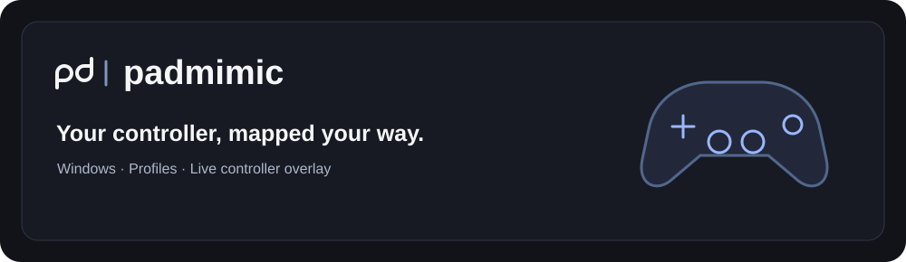
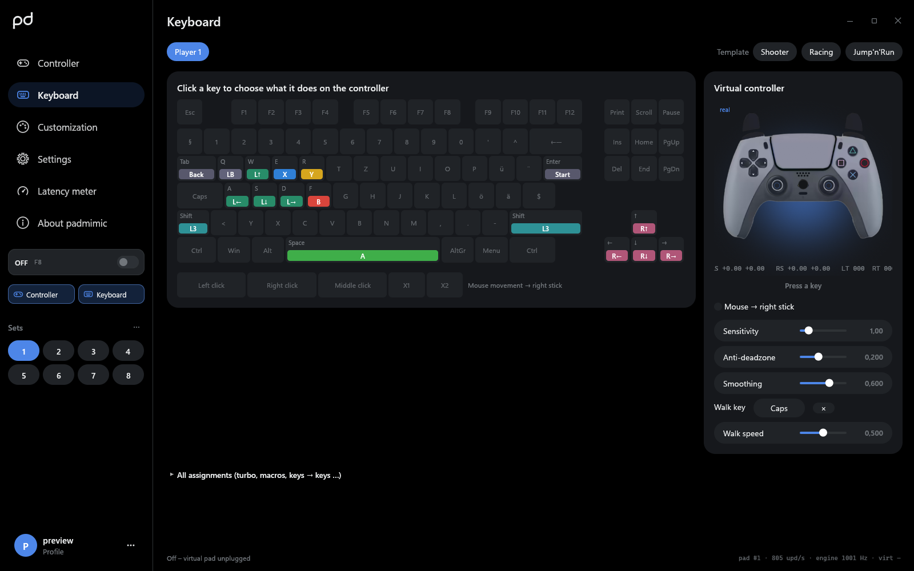
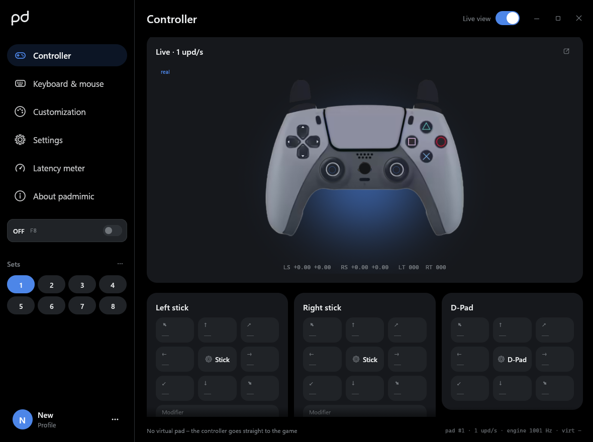
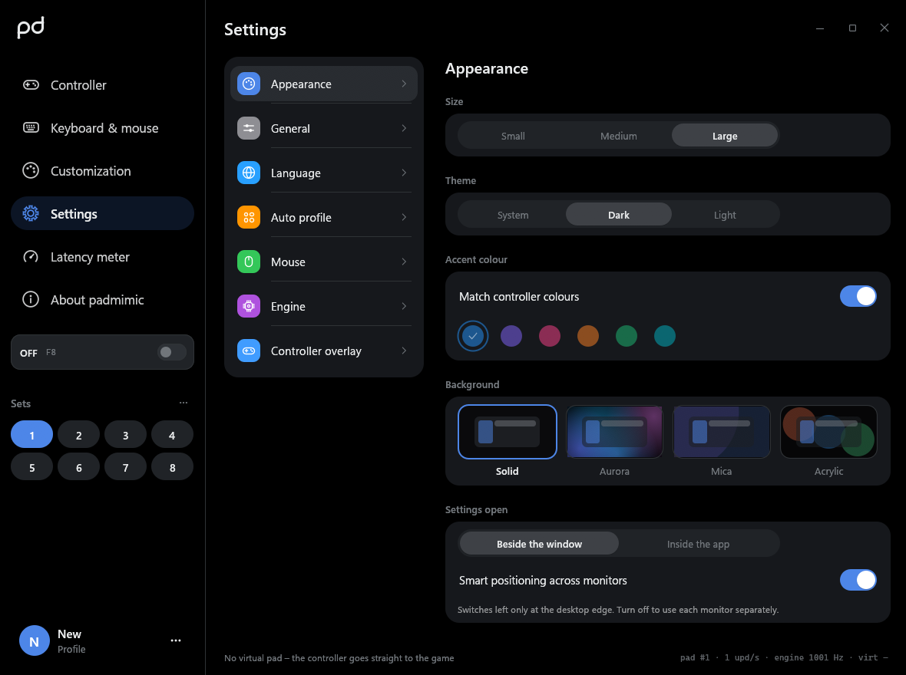

# padmimic

Turn your keyboard, mouse or controller into the inputs your game needs. Build a layout, watch it respond in the live preview, and save it as a profile.

**Windows 10 / 11 · Keyboard and mouse mappings · PlayStation and Xbox controllers**

[Download the latest release](https://github.com/aywalh/padmimic/releases/latest)

## Keyboard to controller

Open **Keyboard** to see your keys and controller preview together. Click a key to choose its controller action, or start with the **Shooter**, **Racing** or **Jump'n'Run** template.

The coloured labels show each key's assigned output. The screenshot uses an example layout with every input released.

- Map WASD and arrow keys to stick directions, and assign other keys to controller buttons.
- Use mouse movement for the right stick, with sensitivity, anti-deadzone and smoothing controls.
- Set a walk key and walk speed for finer movement.
- Assign additional keyboards to virtual players 2–4 from the device list in **Controller**.
- Switch controller mappings and keyboard mappings on or off independently.

Enable **Keyboard** mappings, turn padmimic **On**, and use the live preview to check your layout. Virtual Xbox 360 output requires [ViGEmBus](https://github.com/nefarius/ViGEmBus).

## Remap your controller

Connect your pad and open **Controller** to check live inputs. Assign an output to a button, stick direction or trigger, then save the mappings as a profile. Each profile has up to eight mapping sets.

DualShock 4 and DualSense input is supported over USB and Bluetooth. Choose **Automatic layout** in Customization to match the preview and pop-out to the detected controller. Touchpad clicks and supported DualSense mute-button reports can be mapped in the Buttons card.

## Choose your controller design

Pick from **39 static designs** under **Customization**, or import your own skin. Buttons, sticks and triggers react to live input.

Browse a selection of controller designs

## Put the controller on stream

Open the pop-out from the live preview or **Settings → Controller overlay**. Drag it to move, resize from an edge, and enable click-through when it is in place. For Discord, share the screen that contains the overlay.

Appearance settings

## Install or build

- **padmimic-setup.exe** installs per user on Windows 10 or 11.
- **padmimic.exe** runs as a portable app. Settings and profiles live beside the executable.
- Virtual controller output needs **ViGEmBus**. Mapping a controller to keyboard or mouse actions works without that driver.

Run `cargo test --locked` to test and `./release.ps1` to build with remapped build paths. Padmimic checks the official GitHub release by default. To build against another update repository, set `PADMIMIC_UPDATE_REPOSITORY` to its public `owner/name` at build time.

[MIT License](LICENSE) · [Controller catalog](docs/controllers.md) · [Overlay guide](docs/controller-overlay.md)
