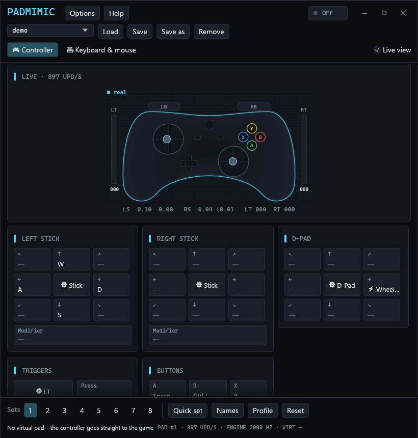
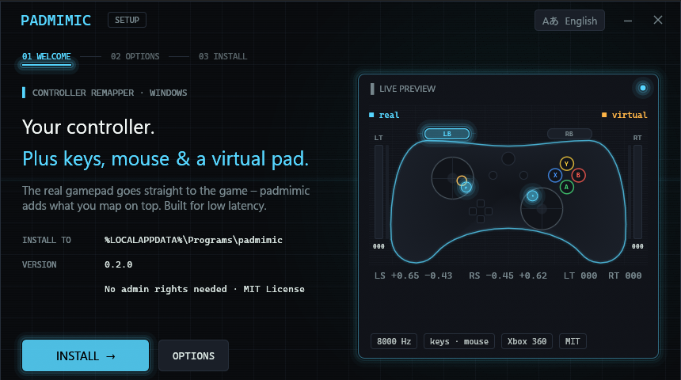

# padmimic

Controller remapper for Windows, in the spirit of [AntiMicroX](https://github.com/AntiMicroX/antimicrox):
your real gamepad goes straight to the game, and padmimic adds keyboard keys, mouse movement, mouse
wheel and a virtual Xbox 360 controller on top — built for low input latency.



## Features

- Map every button, stick direction, trigger and D-pad direction to keys, mouse buttons, mouse
  movement, wheel or virtual Xbox 360 controller outputs
- AntiMicroX-style logic: slot sequences (hold, release, pause, cycle, distance zones, mouse speed
  modifiers, text, run program, load profile), toggle, turbo (normal / gradient / pulse), 8 sets
  with one-way / two-way / while-held switching, dead / max / square zones, mouse curves and
  delta acceleration, spring mode
- Keyboard & mouse → controller bindings and mouse → stick aim
- Profiles, auto-profile per foreground program
- Up to 8000 Hz engine on a high-resolution timer; system-wide input hooks only while they are needed
- Live controller view, latency meter in its own window
- English, Deutsch, 日本語, 简体中文, 한국어, Tiếng Việt, Filipino, العربية
- Updates itself from GitHub releases (checksum-verified)

## Download

From the [latest release](https://github.com/aywalh/padmimic/releases/latest):

- **`padmimic-setup.exe`** — installer. Per user, no admin rights: installs to
  `%LOCALAPPDATA%\Programs\padmimic`, adds Start menu / desktop shortcuts and an entry in Windows
  *Apps*, where it can be uninstalled again.
- **`padmimic.exe`** — portable: put it in its own folder and run it.

Settings and profiles are stored next to the exe. Both versions update themselves.



Requirements: Windows 10 or 11 (64-bit).

- For virtual controller outputs padmimic needs the [ViGEmBus](https://github.com/nefarius/ViGEmBus)
  driver; it offers to install it for you.
- Games still see your real controller as well. To hide it, use
  [HidHide](https://github.com/nefarius/HidHide) and allow `padmimic.exe` there.

## Build from source

```
cargo build --release
```

The exe is `target/release/padmimic.exe`. Tests: `cargo test --release`.

The installer is the same exe: a copy whose name contains `setup` (or started with `--install`)
shows the setup, `--uninstall` removes an installed copy (see `src/setup.rs`).

## Releasing

1. Set the new `version` in `Cargo.toml` and commit.
2. Tag and push: `git tag v0.2.0 && git push origin v0.2.0`.

GitHub Actions builds the exe, writes `padmimic.exe.sha256`, adds `padmimic-setup.exe` and
publishes the release; running copies of padmimic offer the update on their next start.

## Translations

`lang/_keys.json` lists every English UI text; each `lang/<code>.json` maps it to a translation.
Missing entries fall back to English. Keep every `{}` placeholder.

## License

MIT, see [LICENSE](LICENSE). padmimic is an independent project and not affiliated
with AntiMicroX, Microsoft or Nefarius.
