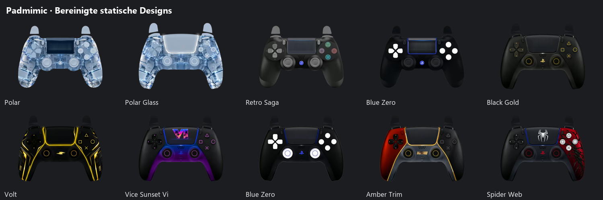

# padmimic

Map your controller to keys, mouse actions or a virtual Xbox 360 pad. Save layouts as profiles and check each input in the live preview.

## Set up a profile

1. Connect your pad and open **Controller** to check live inputs.
2. Assign an output to a button, stick direction or trigger. Save the mappings as a profile.
3. Turn padmimic **On**. Switch between up to eight mapping sets while playing.

## Make it yours

Choose from **39 static designs** under **Customization**, or import your own skin. Buttons, sticks and triggers respond to live input.

See some of the controller designs

## Put the controller on stream

Open the pop-out from the live preview or **Settings → Controller overlay**. Drag it to move, resize from an edge, and enable click-through when it is in place. For Discord, share the screen that contains the overlay.

See the appearance settings

## Install or build

- **`padmimic-setup.exe`** installs per user on Windows 10 or 11.
- **`padmimic.exe`** is portable. Its settings and profiles live beside the executable.
- For virtual gamepad output, install [ViGEmBus](https://github.com/nefarius/ViGEmBus). Keyboard and mouse mappings can be used without that driver.

Run `cargo test --locked` to test and `./release.ps1` to build with remapped build paths. For automatic update checks in self-built copies, set `PADMIMIC_UPDATE_REPOSITORY` to a public repository in `owner/name` format at build time. Other builds can be updated manually.

[MIT License](LICENSE) · [Controller catalog](docs/controllers.md) · [Overlay guide](docs/controller-overlay.md)
